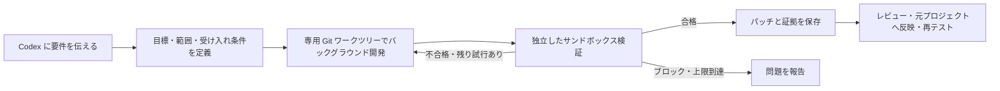

# Telos

[English](README.md) · [简体中文](README.zh-CN.md) · [日本語](README.ja.md) · [한국어](README.ko.md)

**Codex で伝えた要件を、継続して実行・検証できる開発ループに。**

Telos は、目標の永続化、分離された実行環境、独立した受け入れ検証、回数制限付きの
再試行を Codex に追加するローカルの Rust サービスです。対話の窓口とコーディング
エージェントは引き続き Codex が担います。目標・進捗・証拠は会話とは別に保存されるため、
同じ Loop の進捗確認、一時停止、後日の再開ができます。
本文の「対話側」とは、インストール済みの Skill とローカルツールを使って Telos を操作する Codex チャットを指します。

エージェントの「完了しました」という報告だけでは検証済みになりません。
設定したチェックが対象の成果物に対して合格した場合に、Telos が納品目標を完了します。
パッチと証拠を保存し、対話側でレビューしてから元のプロジェクトに反映します。

**現在の状態：**初期 v0.1。ローカル開発の一連の流れは macOS で検証済みです。
Web UI はありません。リモート共有テスト環境、本番の自動修復、長期間の信頼性については
追加の検証が必要です。OpenAI の公式製品ではありません。

## Loop の仕組み



Telos は永続化、スケジューリング、実行の所有権、試行回数、証拠の管理を担当します。
プロジェクトのツール、テストコマンド、観測ソースをアダプターで接続し、
共通の Loop ワークフローを利用できます。
v0.1 の自動コード修正はローカルの納品目標が対象です。継続目標は観測と読み取り専用の診断に対応し、
本番の自動修復・デプロイには対応しません。新しいログ形式には専用の正規化アダプターが必要であり、
イベント一覧が空でも正常性を証明したことにはなりません。
プロジェクト側の収集処理は、バージョン管理と重複排除付きの収集記録を送信できます。
継続目標は独立した読み取り専用 JSON プローブに対応し、アクションの記録後に新しい復旧確認期間を
要求できます。デプロイ処理はプロジェクト側に残します。
[プロジェクト観測プロトコル](docs/PROJECT-OBSERVATION-PROTOCOL.md)を参照してください。

## macOS へのインストール

### 1. 必要なツールを用意する

| ツール | 用途 |
| --- | --- |
| Cargo を含む Rust ツールチェーンと Git | Telos のビルドとワークツリー作成。ローカル検証では Rust 1.91.0 を使用。 |
| `PATH` 上にあり、ログイン済みの Codex CLI | バックグラウンドエージェントと独立したネイティブサンドボックス。本文のコマンドは CLI 0.145.0 と照合済み。 |
| 同じマシン上の Codex チャット | 通常の操作窓口。CLI と同じ Codex home を使用。 |
| Python 3 と Node.js | 下記のリンクチェッカー例と任意のデモに必要。Telos デーモン自体には不要。 |

Rust は [rustup](https://www.rust-lang.org/tools/install) で導入してください。
Codex は [公式 Codex CLI ガイド](https://learn.chatgpt.com/docs/codex/cli) に従って導入します。
macOS 用のスタンドアロンインストーラーは次のコマンドで実行できます。

```sh
curl -fsSL https://chatgpt.com/codex/install.sh | sh
```

インストーラーの案内に従って `PATH` を設定し、新しいターミナルを開いてログインします。

```sh
codex --version
codex login
codex login status
```

既存の Codex ログインを利用します。通常のセットアップでは Telos 専用の API キーは不要です。
実際のエージェント実行は Codex のモデル利用量を消費します。
[公式の認証ガイド](https://learn.chatgpt.com/docs/auth)も参照してください。

### 2. Telos をビルドする

```sh
git clone https://github.com/wp3xpp/Telos.git
cd Telos
cargo build --release --locked
```

### 3. バイナリ、Skill、MCP 接続をインストールする

以降のシェルコマンドは同じターミナルで実行してください。これは**新規インストール**用です。
導入済みの場合は[アップグレード手順](docs/INSTALL.md#upgrade)を使用してください。

```sh
export TELOS_PREFIX="$HOME/Library/Application Support/Telos/install"
export TELOS_STATE="$HOME/Library/Application Support/Telos/state"
export TELOS_CODEX_HOME="${CODEX_HOME:-$HOME/.codex}"
export TELOS_CODEX_BIN="$(command -v codex)"

mkdir -p "$(dirname "$TELOS_PREFIX")" "$TELOS_CODEX_HOME"

./target/release/telos --state-dir "$TELOS_STATE" install \
  --prefix "$TELOS_PREFIX" \
  --codex-home "$TELOS_CODEX_HOME" \
  --codex "$TELOS_CODEX_BIN"

export TELOS_BIN="$TELOS_PREFIX/telos"
```

バイナリと `hsw-telos` Skill を配置し、Codex の公開 CLI で `telos` MCP サーバーを登録します。
この操作だけではサービスは**起動せず**、プロジェクトの実行権限も付与しません。
インストール先は未作成のディレクトリである必要があります。状態は Application Support 内の
別ディレクトリに保存します。以降も同じ状態ディレクトリを使用してください。
`CODEX_HOME` を変更している場合は、その既存ディレクトリの絶対パスを一貫して使用します。

### 4. バックグラウンドサービスを起動する

```sh
"$TELOS_BIN" service install \
  --prefix "$TELOS_PREFIX" \
  --codex "$TELOS_CODEX_BIN" \
  --notifications

"$TELOS_BIN" service status --prefix "$TELOS_PREFIX"
```

結果に `"healthy": true` があることを確認します。通知が不要なら `--notifications` を省略します。
LaunchAgent により、ターミナルを閉じてもサービスは動作します。
フォアグラウンド実行やサービス管理については [INSTALL.md](docs/INSTALL.md) を参照してください。

### 5. Codex 内で接続を確認する

**新しい Codex チャット**を開き、次のように依頼します。

> Telos Skill を使用し、`telos_status` MCP ツールを実際に呼び出してサービスの応答を表示してください。
> ターミナルコマンドで代用しないでください。

応答には、以下のフィールドとプロセス ID が含まれます。

```json
{
  "service": "telos",
  "version": "0.1.0",
  "verification_adapters": ["local.sandbox_command", "local.sandbox_json", "local.observation_json"]
}
```

`codex mcp get telos --json` は登録確認用です。現在のチャットからサービスに接続できるかは、
上記の実際の MCP 呼び出しで確認します。インストール成功だけでは接続確認になりません。

## 最初の要件から受け入れ完了まで

### 1. コミット済みの Git プロジェクトを開く

対象リポジトリを Codex で開きます。Telos はコミット済みの `HEAD`、または指定した完全な
コミット ID を基点としてワークツリーを作成します。必要な入力が未コミットの場合は、
無関係な変更を巻き込まず、何を先にコミットするか決めてください。

### 2. プロジェクトを初回登録する

そのプロジェクトの Codex チャットで、次を送信します。

```text
現在のプロジェクトに Telos を導入してください。AGENTS.md と既存の登録内容を確認してください。
このプロジェクトについて、分離されたワークツリーでのコード変更とローカルの受け入れテストを
許可します。最初の納品は最大2回の試行とし、デプロイはしません。
既存の登録と権限を再利用してください。設定が不足している場合は、インストール済みの
Telos Skill とローカルのオペレーター CLI で登録し、有効な workspace_write ポリシーを設定してください。
具体的な要件を伝えるまでは目標を作成しないでください。
```

対話側があなたの許可に基づいてローカル設定を行います。MCP ツールが自分に書き込み権限を
付与することはありません。通常、JSON のタスクパッケージを手書きする必要はありません。
詳細は [PROJECTS.md](docs/PROJECTS.md) にあります。

### 3. 具体的な要件を伝える

Python 3 と Node.js を用意して、次の例を試せます。

```text
Telos を使って、外部パッケージに依存しない Node.js CLI「check-links.mjs FILE.md」を実装してください。
通常の Markdown ローカルリンクを検査し、相対パスは入力ファイルのディレクトリから解決します。
山括弧で囲んだ空白・中国語を含む対象と、ファイルの #フラグメントに対応してください。
http:、https:、mailto: とアンカーだけのリンクは無視します。checked、ignored、broken を含む JSON を出力し、
リンク切れなしは終了コード0、リンク切れありは1、引数不足・入力の読み取り不可は2とします。
README.md に使い方を書いてください。完全な CommonMark 対応は対象外です。

実行前に、存在・欠落する対象、無視するリンク、空白・中国語・フラグメント、入れ子の相対パス、
引数不足、読み取り不可を独立して検証するテストを準備してください。
検証スクリプトはバックグラウンド作業から編集できない場所に置いてください。
変更は check-links.mjs と README.md のみ、試行は最大2回です。Loop ID、結果、パッチ、証拠を返してください。
```

Codex が目標の契約とテスト計画を準備し、サービスがワークツリーを作成してバックグラウンドの
Codex を実行します。成果物は独立したサンドボックステストで検証します。
不合格なら上限内で修正し、進められない場合は問題を報告します。無限に再試行はしません。

### 4. 同じ Loop を追跡する

「この Loop の進捗を表示」「この Loop を一時停止」「この Loop を再開」と依頼できます。
別のチャットでは、保存した Loop ID を添えて同じ目標を指定してください。
進捗は `working → verifying → correcting → verifying → completed` のように表示されます。
初回で合格すれば修正は省かれます。待機クライアントを閉じてもバックグラウンド作業は取り消されません。

### 5. 納品内容をレビューして反映する

合格後、次のように依頼します。

```text
この Loop に保存された納品パッチと検証証拠を読み、変更するパスが許可された範囲内かレビューしてください。
問題なく適用できる場合は、レビュー済みのパッチだけを元のプロジェクトに反映し、無関係な変更は残してください。
元のプロジェクトで必要なチェックを再実行して結果を報告してください。コミット、push、デプロイはしません。
```

Loop ID とリビジョン、合格した条件、証拠の参照、レビュー済みの変更ファイル、元プロジェクトでの
再テスト結果を確認できます。`completed` は保存された成果物の合格を意味し、マージやデプロイ済みを意味しません。

**すべての依頼を自動で引き受けますか？** いいえ。新しい目標では「Telos を使って」と明示します。
続きのメッセージは同じ Loop を指定できます。プロジェクトの `AGENTS.md` で既定の運用を決めることは
できますが、インストール時に自動で有効にはなりません。

## 任意：自動デモを再現する

インストール後、Python 3 と Node.js が使える状態で Telos リポジトリから実行します。

```sh
TELOS_DEMO_ROOT="$(mktemp -d "${TMPDIR:-/tmp}/telos-demo.XXXXXX")"
python3 scripts/user_flow_demo.py --adapter local.sandbox_json \
  --output "$TELOS_DEMO_ROOT/run"
```

インストール済みサービスに実際のデモプロジェクトと永続化された目標を作成し、Codex の利用量を消費して
6項目の独立した動作テストを実行し、レビューバンドルを出力します。出力先には未作成の子ディレクトリを使います。
`report.json` に Loop ID が保存されます。タイムアウト後は同じ ID を確認し、重複送信しないでください。
適用前にパッチをレビューしてください。デモのプロジェクトは一時領域に置きますが、サービスの状態は
Application Support に永続保存されます。

## 任意：ターミナルから操作する

上で設定したバイナリと状態ディレクトリの変数を使います。

```sh
"$TELOS_BIN" --state-dir "$TELOS_STATE" follow --id LOOP_ID --once
"$TELOS_BIN" --state-dir "$TELOS_STATE" follow --id LOOP_ID --wait-seconds 600
"$TELOS_BIN" --state-dir "$TELOS_STATE" review \
  --id LOOP_ID --output /absolute/new-review-directory
```

`review` は**新しいディレクトリ**に `changes.patch`、`review.json`、検証証拠、`receipt.json` を書き出します。
保存された証拠の整合性と紐付けを確認し、後から変更されたワークツリーを読んだり、パッチを適用したりはしません。
対話側は準備済みパッケージを `deliver --file /absolute/package.json --wait` で送信します。
`deliver` は毎回新しい目標を作成し、`follow` は既存の目標を参照するだけです。

## トラブルシューティング

| 症状 | 確認すること |
| --- | --- |
| チャットに Telos ツールがない | 新しいチャットを開き、`codex mcp get telos --json` とインストール時の Codex home を確認します。 |
| サービスに接続できない | 同じインストール先で `service status` を実行し、手順4でサービスを起動します。 |
| 実行ポリシーが必要と表示される | 許可に基づく初回設定を行います。登録だけでは書き込み権限は付きません。 |
| エージェントは完了したが目標が未完了 | 独立した検証結果やブロック理由を確認します。実行成功と合格は別です。 |
| 待機がタイムアウトした | Loop ID を保持して `follow` を使います。重複して送信しません。 |
| シェルでは動くが launchd では動かない | サービスは固定 `PATH` を使い、任意のシェル変数を引き継ぎません。スタンドアロン Codex CLI を推奨します。シェルに依存する構成は INSTALL.md のフォアグラウンド実行を参照してください。 |

`"$TELOS_BIN" --state-dir "$TELOS_STATE" doctor` で CLI、ログイン、サービスを診断できますが、
デスクトップ MCP の接続確認の代わりにはなりません。macOS がインストール・更新後にプロジェクトフォルダーの
アクセス権を再確認する場合があります。読み取りタイムアウトは調査対象であり、合格として扱いません。

## 開発と関連資料

```sh
cargo test --workspace --locked
cargo clippy --workspace --all-targets -- -D warnings
cargo fmt --all -- --check
```

ネイティブサンドボックスのチェックには Codex CLI が必要です。実際のエージェントを使うデモにはログインと
モデル利用量も必要です。[テスト](docs/TESTING.md)、[納品ワークツリー](docs/DELIVERY.md)、
[自動修正](docs/REPAIR.md)、[アダプター構成](docs/ADAPTER-ARCHITECTURE.md)、
[状態と未完了の検証](docs/STATUS.md)を参照してください。4言語の README は同じ導入フローを扱います。
詳しい資料には現在、英語と中国語が混在しています。

## ライセンス

[MIT](LICENSE)。
