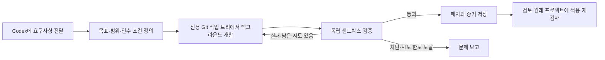

# Telos

[English](README.md) · [简体中文](README.zh-CN.md) · [日本語](README.ja.md) · [한국어](README.ko.md)

**Codex에 전달한 요구사항을 지속적으로 실행하고 검증하는 개발 루프로 만듭니다.**

Telos는 Codex에 목표 영속화, 격리된 실행 환경, 독립적인 인수 검증, 횟수가 제한된 재시도를
추가하는 로컬 Rust 서비스입니다. 대화 창구와 코딩 에이전트는 계속 Codex가 담당합니다.
목표·진행 상황·증거는 대화와 별도로 저장하므로 같은 Loop를 조회하거나 일시 중지하고,
나중에 다시 이어서 관리할 수 있습니다.
여기서 “대화 쪽”은 설치된 Skill과 로컬 도구로 Telos를 조정하는 현재 Codex 대화를 뜻합니다.

에이전트가 “완료했다”고 말하는 것만으로는 검증이 끝나지 않습니다. 설정된 검사가 해당
산출물에 대해 통과해야 Telos가 납품 목표를 완료합니다. 패치와 증거를 저장하고,
대화 쪽에서 패치를 검토한 뒤 원래 프로젝트에 적용합니다.

**현재 상태:** 초기 v0.1이며 로컬 개발 흐름을 macOS에서 검증했습니다. Web UI는 없습니다.
원격 공유 테스트 환경, 운영 환경 자동 복구, 장기간 신뢰성은 추가 검증이 필요합니다.
OpenAI의 공식 제품이 아닙니다.

## Telos가 적합한 작업

독립 테스트로 인수 여부를 판단할 수 있는 로컬 코드 납품부터 적용해 보세요. 예를 들어 격리된
작업 트리에서 CLI의 드라이런 모드를 구현하고, 변경 예정 내역이 표시되며 입력이 보존되는지
검증합니다. 저장된 패치와 테스트 증거를 검토하고, 다른 Codex 세션에서 같은 목표를 이어서 확인할 수 있습니다.

각 주기에서 출처, 버전, 관찰 기간에 연결된 증거가 필요하거나 진단, 수정 납품, 복구 확인을
별도로 기록해야 한다면 지속 목표가 적합합니다. 수집, 판정 기준, 운영 작업은 프로젝트에서 제공합니다.

작은 일회성 수정은 Codex에 바로 요청하세요. 안전하게 다시 실행할 수 있는 정기 읽기 전용 점검은
스크립트와 스케줄러로 실행하고 필요에 따라 체크포인트와 결과를 저장하세요.
[로컬 개발 흐름](docs/MAIN-FLOW.md)을 참고하세요.

## Loop의 동작 방식



Telos는 영속화, 스케줄링, 실행 소유권, 시도 횟수, 증거 관리를 담당합니다.
프로젝트의 도구, 테스트 명령, 관찰 소스를 어댑터로 연결하여
공통 Loop 워크플로를 사용할 수 있습니다.
v0.1의 자동 코드 수정은 로컬 납품 목표에 한정됩니다. 지속 목표는 관찰과 읽기 전용 진단을 지원하지만
운영 환경 자동 수정이나 배포는 수행하지 않습니다. 새로운 로그 형식에는 별도의 정규화 어댑터가 필요하며,
빈 이벤트 목록은 상태 정상의 증거가 아닙니다.
프로젝트 수집기는 버전 관리와 중복 제거가 적용된 수집 기록을 제출할 수 있으며,
지속 목표는 독립적인 읽기 전용 JSON 관찰 프로브를 실행할 수 있습니다.
작업 기록 뒤에 새로운 복구 관찰 기간을 요구할 수 있지만 배포 코드는 프로젝트 쪽에 둡니다.
[프로젝트 관찰 프로토콜](docs/PROJECT-OBSERVATION-PROTOCOL.md)을 참고하세요.

## macOS에 설치하기

### 1. 필요한 도구 준비

| 도구 | 용도 |
| --- | --- |
| Cargo가 포함된 Rust 도구 모음과 Git | Telos 빌드 및 작업 트리 생성. 로컬 검증에서는 Rust 1.91.0을 사용했습니다. |
| `PATH`에 등록되고 로그인된 Codex CLI | 백그라운드 에이전트 및 독립 네이티브 샌드박스. 문서의 명령은 CLI 0.145.0과 대조했습니다. |
| 같은 컴퓨터의 Codex 대화 | 일반적인 사용 창구. CLI와 같은 Codex home을 사용합니다. |
| Python 3와 Node.js | 아래 링크 검사기 예제와 선택 사항인 데모에 필요합니다. Telos 데몬 자체에는 필요하지 않습니다. |

Rust는 [rustup](https://www.rust-lang.org/tools/install)으로 설치하세요.
Codex는 [공식 Codex CLI 가이드](https://learn.chatgpt.com/docs/codex/cli)에 따라 설치합니다.
macOS용 독립 설치 프로그램의 명령은 다음과 같습니다.

```sh
curl -fsSL https://chatgpt.com/codex/install.sh | sh
```

설치 프로그램 안내에 따라 `PATH`를 설정하고 새 터미널을 열어 로그인합니다.

```sh
codex --version
codex login
codex login status
```

기존 Codex 로그인을 사용합니다. 일반적인 설치에는 별도의 Telos API 키가 필요하지 않습니다.
실제 에이전트 실행은 Codex 모델 사용량을 소비합니다.
[공식 인증 가이드](https://learn.chatgpt.com/docs/auth)도 참고하세요.

### 2. Telos 빌드

```sh
git clone https://github.com/wp3xpp/Telos.git
cd Telos
cargo build --release --locked
```

### 3. 실행 파일, Skill, MCP 연결 설치

이후의 셸 명령은 같은 터미널에서 실행하세요. **신규 설치**용 명령입니다.
이미 설치했다면 [업그레이드 안내](docs/INSTALL.md#upgrade)를 따르세요.

```sh
export TELOS_PREFIX="$HOME/Library/Application Support/Telos/install"
export TELOS_STATE="$HOME/Library/Application Support/Telos/state"
export TELOS_CODEX_HOME="${CODEX_HOME:-$HOME/.codex}"
export TELOS_CODEX_BIN="$(command -v codex)"

mkdir -p "$(dirname "$TELOS_PREFIX")" "$TELOS_CODEX_HOME"

./target/release/telos --state-dir "$TELOS_STATE" install \
  --prefix "$TELOS_PREFIX" \
  --codex-home "$TELOS_CODEX_HOME" \
  --codex "$TELOS_CODEX_BIN"

export TELOS_BIN="$TELOS_PREFIX/telos"
```

실행 파일과 `hsw-telos` Skill을 설치하고 Codex의 공개 CLI로 `telos` MCP 서버를 등록합니다.
이 단계만으로 서비스가 **시작되거나** 프로젝트 실행 권한이 부여되지는 않습니다.
설치 경로는 아직 존재하지 않아야 합니다. 상태는 Application Support의 별도 디렉터리에
저장됩니다. 이후에도 같은 상태 디렉터리를 사용하세요. `CODEX_HOME`을 지정했다면
기존 설정 디렉터리의 절대 경로를 일관되게 사용하세요.

### 4. 백그라운드 서비스 시작

```sh
"$TELOS_BIN" service install \
  --prefix "$TELOS_PREFIX" \
  --codex "$TELOS_CODEX_BIN" \
  --notifications

"$TELOS_BIN" service status --prefix "$TELOS_PREFIX"
```

결과에서 `"healthy": true`를 확인하세요. 알림이 필요 없으면 `--notifications`를 생략합니다.
LaunchAgent가 현재 터미널과 독립적으로 서비스를 실행합니다.
포그라운드 실행 방법과 서비스 관리 명령은 [INSTALL.md](docs/INSTALL.md)에 있습니다.

### 5. Codex에서 연결 확인

**새 Codex 대화**를 열고 다음과 같이 요청하세요.

> Telos Skill을 사용해 `telos_status` MCP 도구를 실제로 호출하고 서비스 응답을 보여 주세요.
> 터미널 명령으로 대신하지 마세요.

응답에는 프로세스 ID와 함께 다음 필드가 포함되어야 합니다.

```json
{
  "service": "telos",
  "version": "0.1.0",
  "verification_adapters": ["local.sandbox_command", "local.sandbox_json", "local.observation_json"]
}
```

`codex mcp get telos --json`은 등록 여부를 확인합니다. 현재 대화에서 서비스에 접근할 수
있는지는 위의 실제 MCP 호출로 확인해야 합니다. 설치 성공만으로 연결이 입증되지는 않습니다.

## 첫 요구사항부터 인수 검증 완료까지

### 1. 커밋이 있는 Git 프로젝트 열기

Codex에서 대상 저장소를 엽니다. Telos는 커밋된 `HEAD` 또는 지정한 전체 커밋 ID를 기준으로
작업 트리를 만듭니다. 필요한 입력이 아직 커밋되지 않았다면 관련 없는 변경을 포함하지 않고
무엇을 먼저 커밋할지 결정하세요.

### 2. 프로젝트 최초 등록

해당 프로젝트의 Codex 대화에 다음을 입력합니다.

```text
현재 프로젝트에 Telos를 연결해 주세요. AGENTS.md와 기존 프로젝트 등록을 먼저 확인하세요.
이 프로젝트의 격리된 작업 트리에서 코드 변경과 로컬 인수 테스트를 허용합니다.
첫 납품은 최대 두 번 시도하고 배포하지 마세요. 기존 등록과 권한을 재사용하세요.
설정이 없다면 설치된 Telos Skill과 로컬 운영자 CLI로 저장소를 등록하고,
활성화된 workspace_write 정책을 설정하세요. 구체적인 요구사항을 주기 전에는 목표를 만들지 마세요.
```

대화 쪽에서 사용자의 승인에 따라 로컬 설정을 수행합니다. MCP 도구가 스스로 쓰기 권한을
부여하지는 않습니다. 일반적으로 JSON 작업 패키지를 직접 작성할 필요는 없습니다.
운영자 수준의 설정은 [PROJECTS.md](docs/PROJECTS.md)를 참고하세요.

### 3. 구체적인 요구사항 전달

Python 3와 Node.js를 설치한 뒤 아래 예제를 사용해 보세요.

```text
Telos로 외부 패키지에 의존하지 않는 Node.js CLI check-links.mjs FILE.md를 구현해 주세요.
일반 Markdown 로컬 링크를 검사하고 상대 경로는 입력 파일의 디렉터리를 기준으로 해석하세요.
꺾쇠괄호로 감싼 공백/중국어 대상과 파일 #프래그먼트를 지원하세요.
http:, https:, mailto: 및 앵커만 있는 링크는 무시하세요. checked, ignored, broken 대상을 포함하는
JSON을 출력하세요. 끊어진 링크가 없으면 종료 코드 0, 있으면 1, 인수 누락 또는 읽을 수 없는 입력은 2입니다.
README.md에 사용법을 작성하세요. 전체 CommonMark 구현은 범위에 포함하지 않습니다.

작업을 보내기 전에 존재/누락 대상, 무시할 링크, 공백/중국어/프래그먼트, 중첩 상대 경로,
인수 누락, 읽을 수 없는 입력을 확인하는 독립 검사를 준비하세요.
검증 스크립트는 백그라운드 작업이 편집할 수 없는 위치에 두세요.
check-links.mjs와 README.md만 변경하고 최대 두 번 시도하세요. Loop ID, 결과, 패치와 증거를 반환하세요.
```

Codex가 목표 계약과 테스트 계획을 준비하고, 서비스가 작업 트리를 생성해 백그라운드 Codex를
실행합니다. 결과는 독립 샌드박스 테스트로 검증합니다. 실패하면 한도 내에서 수정하고,
진행할 수 없는 경우에는 문제를 보고합니다. 무한히 재시도하지 않습니다.

### 4. 같은 Loop 추적

“이 Loop의 진행 상황을 보여 줘”, “이 Loop를 일시 중지해”, “이 Loop를 재개해”라고 요청하세요.
다른 대화로 옮기면 저장한 Loop ID를 함께 전달해 같은 목표를 찾으세요.
진행 상태는 `working → verifying → correcting → verifying → completed`처럼 표시될 수 있습니다.
처음에 통과하면 수정 단계를 건너뜁니다. 대기 클라이언트를 닫아도 백그라운드 작업은 취소되지 않습니다.

### 5. 납품 결과 검토 및 적용

검증 통과 후 다음과 같이 요청합니다.

```text
이 Loop에 저장된 납품 패치와 인수 검증 증거를 읽고 변경 경로가 허용된 범위에 속하는지 검토하세요.
문제없이 적용할 수 있다면 검토한 패치만 원래 프로젝트에 반영하고 관련 없는 변경은 보존하세요.
원래 프로젝트에서 필요한 검사를 다시 실행하고 결과를 보고하세요. 커밋, push, 배포는 하지 마세요.
```

Loop ID와 리비전, 통과한 조건, 증거 참조, 검토한 변경 파일, 원래 프로젝트의 재검사 결과를
확인해야 합니다. `completed`는 저장된 산출물의 검증 통과를 뜻하며, 이미 병합하거나 배포했다는 뜻은 아닙니다.

**모든 요청을 자동으로 맡나요?** 아닙니다. 새 목표에는 “Telos로”라고 명시하세요.
후속 메시지는 같은 Loop를 가리킬 수 있습니다. 프로젝트 `AGENTS.md`에 기본 사용 규칙을 정할 수는
있지만 설치만으로 자동 활성화되지는 않습니다.

## 선택 사항: 자동 데모 재현

설치가 끝나고 Python 3와 Node.js가 준비되면 Telos 저장소에서 실행하세요.

```sh
TELOS_DEMO_ROOT="$(mktemp -d "${TMPDIR:-/tmp}/telos-demo.XXXXXX")"
python3 scripts/user_flow_demo.py --adapter local.sandbox_json \
  --output "$TELOS_DEMO_ROOT/run"
```

설치된 서비스에 실제 데모 프로젝트와 영속 목표를 만들고 Codex 사용량을 소비하며,
6개의 독립 동작 테스트를 실행하고 검토 번들을 내보냅니다. 출력은 아직 없는 하위 디렉터리를 사용합니다.
`report.json`에 Loop ID가 저장됩니다. 타임아웃 후에는 같은 ID를 조회하고 중복 제출하지 마세요.
적용 전에 내보낸 패치를 검토하세요. 데모 프로젝트는 임시 디렉터리를 사용하지만,
서비스의 영속 상태는 Application Support에 보관됩니다.

## 선택 사항: 터미널 단축 명령

앞에서 정의한 설치 경로와 상태 디렉터리 변수를 사용합니다.

```sh
"$TELOS_BIN" --state-dir "$TELOS_STATE" follow --id LOOP_ID --once
"$TELOS_BIN" --state-dir "$TELOS_STATE" follow --id LOOP_ID --wait-seconds 600
"$TELOS_BIN" --state-dir "$TELOS_STATE" review \
  --id LOOP_ID --output /absolute/new-review-directory
```

`review`는 **새 디렉터리**에 `changes.patch`, `review.json`, 검증 증거, `receipt.json`을 내보냅니다.
저장된 증거의 무결성과 연결 관계를 확인하며, 나중에 수정된 작업 트리를 읽거나 패치를 자동 적용하지 않습니다.
대화 쪽에서는 `deliver --file /absolute/package.json --wait`로 준비된 작업 패키지를 제출합니다.
`deliver`는 매번 새 목표를 만들고, `follow`는 기존 목표를 조회하기만 합니다.

## 문제 해결

| 현상 | 확인할 사항 |
| --- | --- |
| 대화에 Telos 도구가 없음 | 새 대화를 열고 `codex mcp get telos --json`과 설치에 사용한 Codex home을 확인하세요. |
| 서비스에 연결되지 않음 | 같은 설치 경로로 `service status`를 실행하고 4단계에 따라 서비스를 시작하세요. |
| 프로젝트 실행 정책이 필요하다는 메시지 | 허용된 최초 설정을 수행하세요. 등록만으로 쓰기 권한이 생기지 않습니다. |
| 에이전트는 끝났지만 목표가 미완료 | 독립 검증 결과나 차단 증거를 읽으세요. 실행 성공과 검증 통과는 다릅니다. |
| 대기 시간 초과 | 저장한 Loop ID로 `follow`를 사용하고 중복 제출하지 마세요. |
| 셸에서는 되지만 launchd에서는 실패 | 서비스는 고정 `PATH`를 사용하고 임의의 셸 변수를 상속하지 않습니다. 독립형 Codex CLI를 우선 사용하세요. 셸 의존 설정은 INSTALL.md의 포그라운드 실행 방법을 참고하세요. |

`"$TELOS_BIN" --state-dir "$TELOS_STATE" doctor`로 CLI, 로그인, 서비스를 진단할 수 있지만
데스크톱 MCP 연결 확인을 대신하지는 않습니다. macOS가 설치 또는 업데이트 후 프로젝트 폴더 접근을
재확인할 수 있습니다. 읽기 타임아웃은 조사해야 할 문제이며 통과로 처리하지 않습니다.

## 개발 및 참고 문서

```sh
cargo test --workspace --locked
cargo clippy --workspace --all-targets -- -D warnings
cargo fmt --all -- --check
```

네이티브 샌드박스 검사에는 Codex CLI가 필요하고, 실제 에이전트 데모에는 로그인과 모델 사용량도
필요합니다. [테스트](docs/TESTING.md), [작업 트리](docs/DELIVERY.md), [자동 수정](docs/REPAIR.md),
[어댑터 구조](docs/ADAPTER-ARCHITECTURE.md), [상태와 남은 검증](docs/STATUS.md)을 참고하세요.
네 언어의 README는 같은 시작 절차를 다룹니다. 더 자세한 문서는 현재 영어와 중국어가 섞여 있습니다.

## 라이선스

[MIT](LICENSE).
