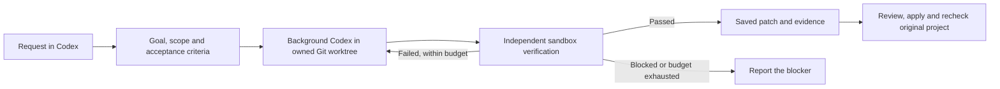

# Telos

[English](README.md) · [简体中文](README.zh-CN.md) · [日本語](README.ja.md) · [한국어](README.ko.md)

**Turn a request in Codex into a persistent development-and-verification loop.**

Telos is a local Rust service that gives Codex durable goals, isolated execution,
independent acceptance checks, and bounded retries. Codex remains your chat interface
and coding agent. Telos keeps the goal and its evidence outside the conversation,
so you can inspect progress, pause work, and return to the same Loop later.
Here, “frontend” means your Codex chat coordinating Telos through the installed
Skill and local tools.

A worker saying “done” is not acceptance. Telos completes a delivery only when the
configured checks pass for the observed artifact. It saves a patch and evidence;
the frontend reviews the patch before applying it to your original project.

**Status:** early v0.1, with the local development flow validated on macOS. There is
no Web UI. Remote shared-test workflows, production remediation, and long-duration
reliability still need further acceptance. This project is not an official OpenAI product.

## How the Loop works



Telos handles persistence, scheduling, ownership, attempt limits, and evidence.
Project adapters connect your tools, test commands and observation sources to the
same Loop workflow. Automatic code correction
in v0.1 is for local delivery goals. Continuous goals support observation and
read-only diagnosis, not automatic production repair or deployment. A new log
format needs its own normalization adapter; an empty event list is not a health pass.
Project-owned collectors can now submit versioned, deduplicated collection receipts,
and continuous goals can use independent read-only JSON observation probes. Action
receipts can gate a fresh recovery window without putting deployment code into the
engine. See [the project observation protocol](docs/PROJECT-OBSERVATION-PROTOCOL.md).

## Install on macOS

### 1. Prepare the tools

| Tool | Needed for |
| --- | --- |
| Rust toolchain with Cargo, plus Git | Building Telos; creating project worktrees. Local validation used Rust 1.91.0. |
| Codex CLI, available on `PATH` and signed in | Background agents and independent native sandboxes. These docs were checked against CLI 0.145.0. |
| Codex chat on the same machine | Your normal interaction with Telos; use the same Codex home as the CLI. |
| Python 3 and Node.js | The link-checker walkthrough and optional demo below; not the Telos daemon itself. |

Install Rust using [rustup](https://www.rust-lang.org/tools/install). Install Codex
following the [official Codex CLI guide](https://learn.chatgpt.com/docs/codex/cli).
Its standalone macOS installer is:

```sh
curl -fsSL https://chatgpt.com/codex/install.sh | sh
```

Follow the installer's `PATH` instructions, open a new terminal, and sign in:

```sh
codex --version
codex login
codex login status
```

Use your existing Codex login. The ordinary setup does not require a separate Telos
API key. Live agent work consumes your Codex model usage. See the
[official authentication guide](https://learn.chatgpt.com/docs/auth).

### 2. Build Telos

```sh
git clone https://github.com/wp3xpp/Telos.git
cd Telos
cargo build --release --locked
```

### 3. Install the binary, Skill and MCP connection

Run the remaining shell blocks in this same terminal. These are **fresh-install**
commands; an existing installation should follow [the upgrade guide](docs/INSTALL.md#upgrade).

```sh
export TELOS_PREFIX="$HOME/Library/Application Support/Telos/install"
export TELOS_STATE="$HOME/Library/Application Support/Telos/state"
export TELOS_CODEX_HOME="${CODEX_HOME:-$HOME/.codex}"
export TELOS_CODEX_BIN="$(command -v codex)"

mkdir -p "$(dirname "$TELOS_PREFIX")" "$TELOS_CODEX_HOME"

./target/release/telos --state-dir "$TELOS_STATE" install \
  --prefix "$TELOS_PREFIX" \
  --codex-home "$TELOS_CODEX_HOME" \
  --codex "$TELOS_CODEX_BIN"

export TELOS_BIN="$TELOS_PREFIX/telos"
```

This installs the binary and `hsw-telos` Skill, and registers the `telos` MCP server
through the public Codex CLI. It does **not** start the service or authorize a project.
The install prefix must be new. State is kept separately in Application Support;
use this same state directory for later commands. For a custom `CODEX_HOME`, use
its existing absolute path consistently.

### 4. Start the background service

```sh
"$TELOS_BIN" service install \
  --prefix "$TELOS_PREFIX" \
  --codex "$TELOS_CODEX_BIN" \
  --notifications

"$TELOS_BIN" service status --prefix "$TELOS_PREFIX"
```

Look for `"healthy": true`. Notifications are optional; omit `--notifications` if
unwanted. The LaunchAgent keeps the service independent of this terminal.
For a foreground alternative and lifecycle commands, see [INSTALL.md](docs/INSTALL.md).

### 5. Verify the connection inside Codex

Open a **new Codex chat** and ask:

> Use the Telos Skill and actually call `telos_status`. Show the service response.
> Do not substitute a terminal command for this MCP check.

The response should include these fields (and a process ID):

```json
{
  "service": "telos",
  "version": "0.1.0",
  "verification_adapters": ["local.sandbox_command", "local.sandbox_json", "local.observation_json"]
}
```

`codex mcp get telos --json` checks registration; the actual MCP call above checks
that this chat can reach the service. Installation alone does not prove that.

## Your first request → acceptance loop

### 1. Open a committed Git project

Open your target repository in Codex. Telos prepares worktrees from committed `HEAD`
or an explicit full commit ID. Required uncommitted inputs are not included by that
baseline; decide what to commit first, without sweeping unrelated edits into it.

### 2. Onboard the project once

Send this in that project's Codex chat:

```text
Use Telos for the current project. Read AGENTS.md and the existing project registration.
I authorize local code changes in an isolated worktree and local acceptance tests for
this project, with at most two attempts for the first delivery; no deployment.
Reuse existing registration and permissions. If setup is missing, use the installed
Telos Skill and local operator CLI to register this repository and configure an
enabled workspace_write policy. Do not create a goal until I give the requirement.
```

The frontend performs this local setup under your authorization. MCP tools do not
self-grant write access. You normally do not need to write a JSON task package.
See [PROJECTS.md](docs/PROJECTS.md) for the operator-level configuration.

### 3. Submit a concrete requirement

With Python 3 and Node.js installed, try:

```text
Use Telos to implement a dependency-free Node.js CLI: check-links.mjs FILE.md.
It checks ordinary local Markdown links, resolving relative paths against the input
file's directory. Support angle-bracket targets with spaces/Chinese and file #fragments.
Ignore http:, https:, mailto: and anchor-only links. Print JSON with checked, ignored,
and broken targets. Exit 0 for no broken links, 1 for broken links, and 2 for missing
arguments or unreadable input. Document usage in README.md; full CommonMark is out of scope.

Before dispatch, prepare independent checks for existing/broken targets, ignored links,
spaces/Chinese/fragments, nested relative paths, missing arguments, and unreadable input.
Keep acceptance scripts outside the worker-editable scope. Change only check-links.mjs
and README.md, use at most two attempts, and return the Loop ID, result, patch and evidence.
```

Codex prepares the contract and test plan; the daemon creates the worktree and runs
a background Codex worker. Independent sandbox tests verify the result. A failed
check can trigger a correction within the budget; a blocker is reported rather than
retried indefinitely.

### 4. Follow the same Loop

Ask “Show progress for this Loop”, “Pause this Loop”, or “Resume this Loop”. For a new
chat, include the saved Loop ID so it can find the same goal. Progress may show
`working → verifying → correcting → verifying → completed`; a first-pass success
skips correction. Closing the waiting client does not cancel the job.

### 5. Review and apply the delivery

After acceptance, ask:

```text
Read this Loop's saved delivery patch and acceptance evidence. Review the changed
paths against the approved scope, then apply only the reviewed patch to the original
project if it applies cleanly. Preserve unrelated edits. Run the applicable checks
again and report the results. Do not commit, push or deploy.
```

Expect the Loop ID and revision, passed criteria, evidence references, reviewed
changed files, and the original-project check result. `completed` describes the
accepted artifact; it does not mean a patch was already merged or deployed.

**Will Telos take over every request?** No. Explicitly say “use Telos” for a new goal.
Follow-up messages can refer to the same Loop. You can choose a project default in
`AGENTS.md`, but installation does not turn that on automatically.

## Optional: reproduce the automated demo

From the Telos repository after installation, with Python 3 and Node.js available:

```sh
TELOS_DEMO_ROOT="$(mktemp -d "${TMPDIR:-/tmp}/telos-demo.XXXXXX")"
python3 scripts/user_flow_demo.py --adapter local.sandbox_json \
  --output "$TELOS_DEMO_ROOT/run"
```

This creates a real demo project and durable goal in your installed service, uses
Codex model quota, runs six independent behavior tests, and exports a review bundle.
The new child output directory is intentional. `report.json` records the Loop ID;
inspect or follow it after a timeout instead of submitting another copy. Review the
exported patch before applying it. The demo uses temporary project files; your
service's durable state remains in Application Support.

## Optional: terminal shortcuts

For the installed binary/state variables defined above:

```sh
"$TELOS_BIN" --state-dir "$TELOS_STATE" follow --id LOOP_ID --once
"$TELOS_BIN" --state-dir "$TELOS_STATE" follow --id LOOP_ID --wait-seconds 600
"$TELOS_BIN" --state-dir "$TELOS_STATE" review \
  --id LOOP_ID --output /absolute/new-review-directory
```

`review` writes `changes.patch`, `review.json`, acceptance evidence, and `receipt.json`
to a **new** directory. It exports saved evidence with integrity/binding checks; it
neither reads a later live worktree nor applies the patch. The frontend uses
`deliver --file /absolute/package.json --wait` to submit a prepared task package.
Every `deliver` creates a new goal; `follow` only observes an existing one.

## Troubleshooting

| Symptom | What to check |
| --- | --- |
| No Telos tools in a chat | Open a new chat; check `codex mcp get telos --json` and the Codex home used for installation. |
| Service unreachable | Run `service status` with the same install prefix; start the service using step 4. |
| Project needs an execution policy | Perform the authorized onboarding step; registration alone is not write permission. |
| Worker done, goal still incomplete | Read independent verification/blocker evidence; worker success is not acceptance. |
| Wait timed out | Keep the saved Loop ID and use `follow`; do not submit a duplicate. |
| CLI works in a shell, not under launchd | The service has a fixed `PATH` and does not inherit arbitrary shell variables. Prefer the standalone Codex CLI; see the foreground option in INSTALL.md for shell-dependent setups. |

Use `"$TELOS_BIN" --state-dir "$TELOS_STATE" doctor` for CLI/auth/service diagnostics.
It does not prove desktop MCP availability. macOS may recheck project-folder access
after installation or upgrades; an access timeout needs inspection, not a fake pass.

## Development and further reading

```sh
cargo test --workspace --locked
cargo clippy --workspace --all-targets -- -D warnings
cargo fmt --all -- --check
```

Native sandbox checks require the Codex CLI. Live agent harnesses also require login
and model quota. See [testing](docs/TESTING.md), [delivery workspaces](docs/DELIVERY.md),
[automatic correction](docs/REPAIR.md), [adapter architecture](docs/ADAPTER-ARCHITECTURE.md),
and [status / remaining acceptance](docs/STATUS.md).
The multilingual READMEs cover the same onboarding flow; deeper documents currently
mix English and Chinese.

## License

[MIT](LICENSE).
