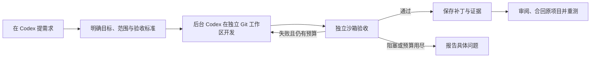

# Telos

[English](README.md) · [简体中文](README.zh-CN.md) · [日本語](README.ja.md) · [한국어](README.ko.md)

**把 Codex 里的一个需求，变成可以持续执行、独立验收的开发闭环。**

Telos 是一个本地 Rust 服务，为 Codex 提供持久化目标、隔离执行、独立验收和有限重试。
Codex 仍然是你的对话入口和编码 Agent；Telos 把目标、进度与证据保存在对话之外，
方便你查看、暂停，以及之后继续跟进同一个 Loop。
下文的“前台”就是当前 Codex 对话，它通过已安装的 Skill 和本地工具协调 Telos。

Agent 说“做完了”不算验收。只有配置的检查针对当前产物通过，Telos 才会完成交付目标。
它保存补丁与证据，由前台审阅后再合回原项目。

**当前状态：**早期 v0.1，本地开发主流程已在 macOS 验证。没有 Web 界面；远端共享测试环境、
生产自动修复和长期可靠性仍需进一步验收。本项目不是 OpenAI 官方产品。

## 什么时候用 Telos

优先用在有独立验收标准的本地代码交付。例如在隔离工作区为命令行工具加上预演模式，
验证它能列出计划变更且保留原始输入，再审阅保存的补丁和测试证据。之后可以在另一个
Codex 会话继续跟进同一个目标。

如果每轮都要按来源、版本和观察窗口保留证据，或者需要分别记录诊断、修复交付和恢复复测，
可以用 Telos 持续目标。采集、验收规则和实际运维动作由项目侧提供。

一次性小改动直接交给 Codex。可以安全重跑的定时只读检查，用脚本加调度即可，按需保存游标
和结果。参见[任务示例](docs/DAILY-USE.md#任务示例)。

## Loop 如何工作



Telos 负责持久化、调度、执行所有权、尝试次数与证据。
通过项目适配器接入工具、测试命令和观察来源，即可使用统一的 Loop 流程。
v0.1 的自动代码修正限于本地交付目标；持续目标支持观察与只读诊断，不能自动修复或发布到生产。
新的日志格式需要自己的归一化适配器，事件列表为空不能视为健康通过。
项目侧采集器现在可提交有版本和去重的采集回执，持续目标可执行独立的只读 JSON 观察探针。
项目动作回执可约束后续的新恢复窗口，部署代码仍留在项目侧。
详见[项目观察协议](docs/PROJECT-OBSERVATION-PROTOCOL.md)。

## 在 macOS 安装

### 1. 准备依赖

| 工具 | 用途 |
| --- | --- |
| Rust 工具链（含 Cargo）与 Git | 编译 Telos、创建项目工作区。本地验证使用 Rust 1.91.0。 |
| 已加入 `PATH` 并登录的 Codex CLI | 后台 Agent 与独立原生沙箱。本文命令对照 CLI 0.145.0 核验。 |
| 同一台机器上的 Codex 对话 | 日常交互入口；与 CLI 使用同一 Codex home。 |
| Python 3、Node.js | 下方链接检查器示例和可选演示需要；Telos 服务本身不依赖它们。 |

通过 [rustup](https://www.rust-lang.org/tools/install) 安装 Rust。
按 [Codex CLI 官方指南](https://learn.chatgpt.com/docs/codex/cli) 安装 Codex；
其中 macOS 独立安装器的命令是：

```sh
curl -fsSL https://chatgpt.com/codex/install.sh | sh
```

按安装器提示配置 `PATH`，打开新终端，再登录：

```sh
codex --version
codex login
codex login status
```

使用已有 Codex 登录即可，普通安装不需要另配 Telos API key。
真实 Agent 执行会消耗 Codex 模型用量。登录方式见 [官方认证说明](https://learn.chatgpt.com/docs/auth)。

### 2. 编译 Telos

```sh
git clone https://github.com/wp3xpp/Telos.git
cd Telos
cargo build --release --locked
```

### 3. 安装程序、Skill 与 MCP 连接

后面的 shell 命令在同一个终端执行。这是**首次安装**步骤；已有安装请按
[升级说明](docs/INSTALL.md#upgrade)操作。

```sh
export TELOS_PREFIX="$HOME/Library/Application Support/Telos/install"
export TELOS_STATE="$HOME/Library/Application Support/Telos/state"
export TELOS_CODEX_HOME="${CODEX_HOME:-$HOME/.codex}"
export TELOS_CODEX_BIN="$(command -v codex)"

mkdir -p "$(dirname "$TELOS_PREFIX")" "$TELOS_CODEX_HOME"

./target/release/telos --state-dir "$TELOS_STATE" install \
  --prefix "$TELOS_PREFIX" \
  --codex-home "$TELOS_CODEX_HOME" \
  --codex "$TELOS_CODEX_BIN"

export TELOS_BIN="$TELOS_PREFIX/telos"
```

它会安装程序与 `hsw-telos` Skill，通过 Codex 公开 CLI 注册 `telos` MCP 服务。
这一步**不会**启动常驻服务，也不会授予项目执行权限。安装目录必须尚不存在；
状态目录独立保存在 Application Support，后续命令沿用同一个目录。
如果自定义了 `CODEX_HOME`，请始终使用该配置目录的绝对路径。

### 4. 启动常驻服务

```sh
"$TELOS_BIN" service install \
  --prefix "$TELOS_PREFIX" \
  --codex "$TELOS_CODEX_BIN" \
  --notifications

"$TELOS_BIN" service status --prefix "$TELOS_PREFIX"
```

结果应包含 `"healthy": true`。不需要通知时，去掉 `--notifications`。
LaunchAgent 让服务独立于当前终端运行；前台运行方式与生命周期命令见 [INSTALL.md](docs/INSTALL.md)。

### 5. 在 Codex 里验证连接

打开一个**新的 Codex 对话**，输入：

> 使用 Telos Skill，实际调用 `telos_status`，把服务返回结果给我。
> 这次请调用 MCP 工具，不要用终端命令代替。

返回应包含以下字段，以及进程 ID：

```json
{
  "service": "telos",
  "version": "0.1.0",
  "verification_adapters": ["local.sandbox_command", "local.sandbox_json", "local.observation_json"]
}
```

`codex mcp get telos --json` 只能检查注册；上面的实际 MCP 调用，才能验证当前对话能访问服务。
安装成功本身不代表桌面接入已经通过。

## 从一个需求走到验收完成

### 1. 打开已有提交的 Git 项目

在 Codex 打开目标仓库。Telos 从已提交的 `HEAD` 或指定的完整提交 ID 创建独立工作区。
未提交的必要输入不会自动进入这个基线；先确定要提交哪些内容，保留其他无关改动。

### 2. 首次接入这个项目

在该项目的 Codex 对话输入：

```text
用 Telos 接入当前项目。先读 AGENTS.md 和现有项目登记。
我授权在独立工作区修改本项目代码并运行本地验收，首次交付最多尝试两次，不部署。
复用已有登记和权限；如果缺少配置，请使用已安装的 Telos Skill 和本地操作员 CLI，
登记当前仓库并配置启用的 workspace_write 策略。先完成接入，等我给具体需求再创建目标。
```

前台在你的授权下完成本地配置；MCP 工具不会自行授予写权限。
通常无需你手写 JSON 任务包。底层配置方式见 [PROJECTS.md](docs/PROJECTS.md)。

### 3. 提交一个具体需求

安装好 Python 3、Node.js 后，可以试这个例子：

```text
用 Telos 实现不依赖第三方包的 Node.js CLI：check-links.mjs FILE.md。
检查普通 Markdown 本地链接，相对路径以输入文件所在目录为基准。
支持尖括号包裹的空格/中文目标和文件 #片段；忽略 http:、https:、mailto: 及纯锚点链接。
输出包含 checked、ignored、broken 目标的 JSON。无断链退出 0，有断链退出 1，
缺少参数或输入不可读退出 2。README.md 写清用法；不实现完整 CommonMark。

派发前准备独立检查，覆盖：存在/缺失目标、应忽略的链接、空格/中文/片段、
嵌套目录相对路径、缺少参数、输入不可读。验收脚本放在后台任务不可编辑的位置。
只修改 check-links.mjs 和 README.md，最多尝试两次，返回 Loop ID、结果、补丁和证据。
```

Codex 整理目标契约和测试方案；常驻服务创建工作区，启动后台 Codex 开发，
再由独立沙箱测试验收。失败时可在预算内继续修正；遇到阻塞会说明问题，不会无限重试。

### 4. 跟踪同一个 Loop

直接说“查看这个 Loop 的进度”“暂停这个 Loop”“继续这个 Loop”。
换对话时带上保存的 Loop ID，才能继续跟进同一个目标。
进度可能显示 `working → verifying → correcting → verifying → completed`；
首次验收通过就不经过修正。关闭等待窗口不会取消后台任务。

### 5. 审阅并合回交付结果

验收通过后输入：

```text
读取这个 Loop 保存的交付补丁和验收证据，对照授权范围审阅修改路径。
如果能干净应用，只把审阅过的补丁合回原项目，保留无关改动。
在原项目重新运行相应检查并报告结果。不提交、不推送、不部署。
```

最终应拿到 Loop ID 与修订、通过的标准、证据引用、审阅后的修改文件，以及原项目重测结果。
`completed` 表示保存的产物通过验收，不表示已经合并或部署。

**会自动接管所有需求吗？**不会。新目标明确说“用 Telos”；后续消息可以直接指代原 Loop。
你可以在项目 `AGENTS.md` 约定默认使用，但安装不会自动开启这个约定。

## 可选：运行完整自动演示

完成安装后，在 Telos 仓库中执行，需有 Python 3、Node.js：

```sh
TELOS_DEMO_ROOT="$(mktemp -d "${TMPDIR:-/tmp}/telos-demo.XXXXXX")"
python3 scripts/user_flow_demo.py --adapter local.sandbox_json \
  --output "$TELOS_DEMO_ROOT/run"
```

它会在安装版服务中登记真实演示项目、创建持久化目标，消耗 Codex 模型用量，
运行六项独立行为测试并导出审阅包。输出使用尚不存在的子目录。
`report.json` 会保存 Loop ID；超时后查原目标，不重复提交。
应用前先审阅导出的补丁。演示项目在临时目录，服务状态仍持久保存在 Application Support。

## 可选：终端快捷命令

使用上面定义的安装版路径与状态变量：

```sh
"$TELOS_BIN" --state-dir "$TELOS_STATE" follow --id LOOP_ID --once
"$TELOS_BIN" --state-dir "$TELOS_STATE" follow --id LOOP_ID --wait-seconds 600
"$TELOS_BIN" --state-dir "$TELOS_STATE" review \
  --id LOOP_ID --output /absolute/new-review-directory
```

`review` 在**新目录**导出 `changes.patch`、`review.json`、验收证据和 `receipt.json`，
检查保存内容的完整性与绑定关系，不读取后来被修改的实时工作区，也不自动应用补丁。
前台用 `deliver --file /absolute/package.json --wait` 提交整理好的任务包。
每次 `deliver` 都创建新目标，`follow` 只查看已有目标。

## 常见问题

| 现象 | 检查方式 |
| --- | --- |
| 对话里没有 Telos 工具 | 新开对话，检查 `codex mcp get telos --json` 和安装时使用的 Codex home。 |
| 无法连接服务 | 用同一个安装目录执行 `service status`，按第 4 步启动服务。 |
| 提示项目缺少执行策略 | 完成已授权的项目接入；登记不等于写权限。 |
| Agent 完成但目标没结束 | 查看独立验收或阻塞证据，执行成功不等于验收通过。 |
| 等待超时 | 保存 Loop ID，用 `follow` 查询，不重新提交。 |
| 终端可用，launchd 下不可用 | 服务使用固定 `PATH`，不继承任意 shell 变量。优先使用独立版 Codex CLI；依赖 shell 环境时参考 INSTALL.md 的前台运行方式。 |

可运行 `"$TELOS_BIN" --state-dir "$TELOS_STATE" doctor` 检查 CLI、登录与服务，
但它不能替代桌面 MCP 验证。macOS 在安装或升级后可能重新检查项目文件夹权限；
读取超时要排查，不能当作验收通过。

## 开发与进一步阅读

```sh
cargo test --workspace --locked
cargo clippy --workspace --all-targets -- -D warnings
cargo fmt --all -- --check
```

原生沙箱检查需要 Codex CLI；真实 Agent 演示还需要登录并会消耗模型用量。
进一步阅读：[独立测试](docs/TESTING.md)、[交付工作区](docs/DELIVERY.md)、
[自动修正](docs/REPAIR.md)、[适配器架构](docs/ADAPTER-ARCHITECTURE.md)、
[状态与剩余验收](docs/STATUS.md)。四份 README 覆盖相同上手流程；更深入的文档目前混用英文和中文。

## 许可证

[MIT](LICENSE)。
