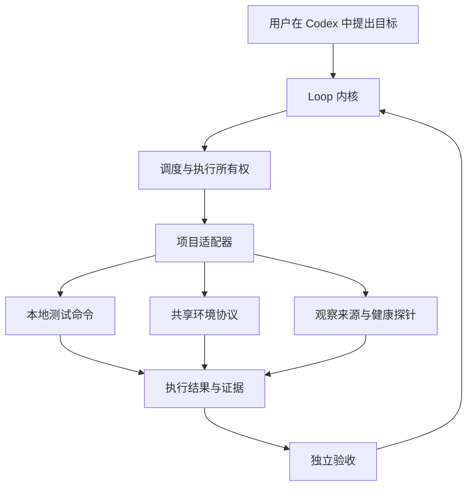

# Telos 通用内核与项目适配器

Telos 以 Loop 为核心：保存目标与验收标准，调度有界执行，记录证据，独立判断本轮结果，再决定继续、等待或结束。项目适配器连接具体工具、测试环境和观察来源。

## 职责划分

| 内核职责 | 适配器职责 |
| --- | --- |
| 目标、验收标准、版本、Loop/Cycle 状态 | 解释项目输入与执行方法 |
| 排队、预算、超时、取消、恢复处置 | 调用工具、项目脚本或服务接口 |
| 验证所有权、工作区与输入快照绑定 | 维护具体环境并确认清理结果 |
| 保存意图、输出、证据引用与审计 | 提供协议要求的测量和结果 |
| 根据证据推进或结束本轮 | 实现项目测试、健康谓词与产物核验 |

项目的编程语言、日志格式、主机、服务路径和部署命令由适配器决定。接入新项目时，复用 Loop 状态机，并配置或实现对应适配器。

## 执行接口

`telos_runtime::external_test::ProjectTestAdapter` 是可信 Rust 实现的执行扩展点：

- `identity` / `metadata`：提供身份、环境标识和不含凭证的配置。
- `prepare`：检查执行前提。
- `execute`：执行一次有界任务并返回输出与清理观察。
- `release`：确认并完成持有资源的清理。
- `fence`：保留不确定结果，等待恢复处置。

通用编排检查验证所有权，记录执行意图，监督超时与取消，核对输入快照并保存输出证据。执行成功之后，仍需独立验收。

## 独立验收接口

`TestVerificationAdapter` 根据操作员配置实施检查。`VerificationPlan.test_checks` 支持：

| `adapter` | 验收依据 |
| --- | --- |
| `local.sandbox_command`（默认） | 沙箱测试命令的退出状态 |
| `local.sandbox_json` | 命令成功退出，并输出匹配验收项的 JSON 断言 |
| `local.observation_json` | 绑定当前请求的独立测量、完整覆盖窗口及新鲜度 |

结构化交付断言示例：`{"criterion_id":"value","verdict":"passed","summary":"actual value approved"}`。命令非零退出不能被通过断言覆盖；无效 JSON 或错误绑定不能通过。省略 `adapter` 时使用默认命令适配器。

观察探针使用单独的只读沙箱和观察协议。它与交付命令共享验证所有权、输出封存及恢复检查机制，采用自己的轮询节奏，不消耗交付开发尝试预算。

## 观察与动作回执

`telos_core::observation` 定义请求绑定、覆盖窗口、来源游标、资源/恢复周期信号和动作回执。

项目采集器负责传输、日志语法和采集频率，通过操作员 API 提交归一化批次。Telos 原子推进游标、记录审计并去重；采集成功本身不表示业务健康。

持续目标通过 `local.observation_json` 执行独立只读探针。项目动作由项目自己的驱动执行；Telos 接收绑定已验收产物的回执，并要求此后的完整观察窗口通过独立验收。

接口与配置示例见[项目观察协议](PROJECT-OBSERVATION-PROTOCOL.md)。

## 扩展范围

当前执行扩展采用静态 Rust 接口，观察适配器可作为外部程序配置；尚不支持动态插件加载。框架不内置业务日志解析器、来源采集命令或部署脚本；这些由项目侧适配器实现。

共享环境执行器仍需接入完整交付验收。远端结果需要独立核验产物、环境和进程身份，才能作为交付证据。参见[环境协调](ENVIRONMENT-LEASE.md)与[剩余验收](ACCEPTANCE-GAPS.md)。
