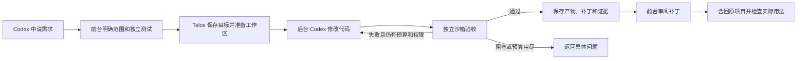

# 日常本地开发

用户入口是 Codex 对话。Telos 在本地常驻，保存目标、执行历史和验收证据。
第一版适合有明确输入、输出和自动测试的本地代码需求。

## 用户怎么说

安装版已在临时目录和文稿目录各完成一次真实开发、独立验收与补丁审阅合回。文稿目录曾发生的系统访问等待已恢复，已有项目上下文读取及权限保持检查均已通过。

首次接入：

> 用 Telos 接入项目 /绝对路径/项目，允许在独立工作区改代码和运行本地测试。

提交需求：

> 用 Telos 给这个项目增加……，验收标准是……。完成后给我补丁和测试结果。

查询或控制：

> 查看这个目标进度。 / 暂停这个目标。 / 继续这个目标。

前台先读项目约定和已有权限，整理需求与独立验收。项目已有登记时复用，
不重复授权。测试文件放在后台任务不可编辑的位置，不能用模型说“完成”代替验收。
独立工作区从已提交的 HEAD（或明确的完整提交 ID）创建；必要输入未提交时先处理基线。

## 实际执行链



关掉等待窗口不会取消后台任务。已拿到目标 ID 后始终跟踪同一个目标，
不要为了看进度再次提交。修改需求、暂停和恢复都读取当前版本后操作。

## 前台使用的本地命令

通过公开的 `codex mcp get telos --json` 读取安装版命令和状态目录。
以下的 TELOS、STATE 是该注册中 command 和 --state-dir 的值。

```sh
"$TELOS" --state-dir "$STATE" deliver --file /absolute/delivery.json --wait
"$TELOS" --state-dir "$STATE" follow --id LOOP_ID --once
"$TELOS" --state-dir "$STATE" follow --id LOOP_ID --wait-seconds 600
"$TELOS" --state-dir "$STATE" review --id LOOP_ID --output /absolute/new-review-directory
```

任务包由前台整理；用户不用编写 JSON。`deliver` 在创建目标前检查服务支持的验收器。
`local.sandbox_command` 运行现有命令并检查退出码；`local.sandbox_json` 运行受限命令，
读取单个 `{criterion_id, verdict, summary}` JSON 结果。即使退出码是 0，JSON 说 failed
也不会通过。新验收器不能自动获得额外执行权限。

`follow` 显示 working、verifying、correcting、completed 或具体阻塞结果。
等待覆盖符合条件的自动修正；超过等待时间只返回当前进度。

`review` 创建一个新目录，包含 changes.patch、review.json、验收证据和最后写入的
receipt.json。导出时核对内容哈希、目标修订和产物身份，读取已保存证据。
前台审阅补丁及验收范围后，在原项目执行 `git apply --check`，再应用相同补丁，
运行相关检查。不自动合并、提交或发布；保留其他未提交改动。后续需求应基于已确认的
项目基线，不能把尚未提交的上一轮结果当作 HEAD 已有内容。

## 第一版验收范围

本地需求 → 真实后台 Codex → 独立验收 → 有限修正 → 保存交付 → 审阅合回。
远端共享测试环境、生产自动修复和长期无人值守可靠性单独验收。
